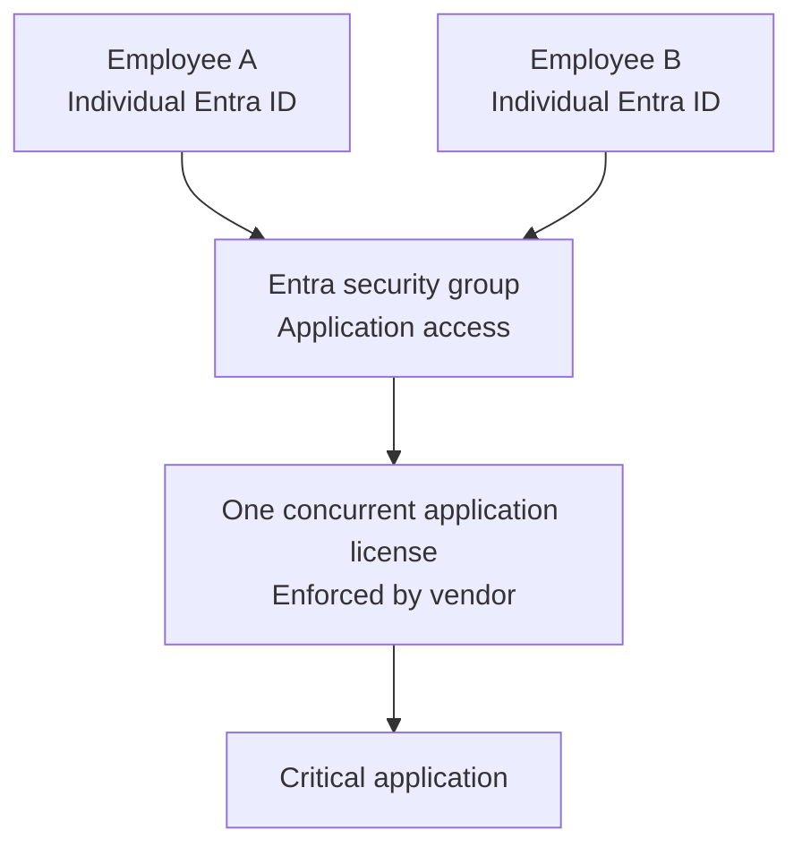

# November 5, 2026 — Shared Account and One Application License

**Status:** Working draft — under review

## Scenario

Two employees share one generic login for a critical application because the organization can afford only one license. Recommend a practical way forward that balances security, accountability, licensing costs, and business continuity.

## Assumptions

- The vendor offers concurrent licensing.
- The application supports individual authentication through Microsoft Entra ID, such as single sign-on (SSO).
- Only one employee needs an active application session at a time.
- The vendor permits both named employees to use a single concurrent license.

## Proposed architecture

*Conceptual access diagram: both employees are individually authenticated; the vendor application, not Entra, enforces the single concurrent license.*

## Proposed solution

Replace the shared generic login with individual Entra identities. Authorize each employee through an Entra security group and use individual SSO to the application. If the vendor supports it, retain one concurrent license, allowing one active user at a time.

## Security and business rationale — to refine

- Individual identity improves attribution and auditability.
- Separate access can be revoked when an employee leaves or changes roles.
- Concurrent licensing may preserve the one-license cost constraint.
- Access remains available to either employee, subject to the one-session limit.

## Verification before implementation

Confirm vendor licensing terms, individual SSO support, concurrency enforcement, and application-level audit records.

## Open items

- Refine the final recommendation in the author's own words.
- Decide whether to include a brief fallback if concurrent licensing is unavailable.
