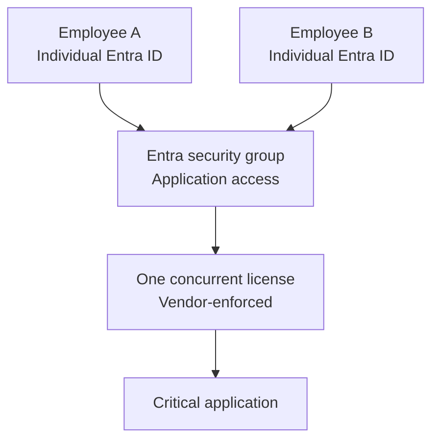

# November 5, 2026 — Shared Account and One Application License

**Working draft**

## Scenario

Two employees share one generic login for a critical application because the organization can afford only one license. Recommend a practical way forward that balances security, accountability, licensing costs, and business continuity.

## Security Risks

- **Accountability / Auditability:** Shared credentials make it difficult to determine which employee performed an action.
- **Credential Compromise:** A third party could obtain the shared credentials and gain unauthorized access.
- **Offboarding / Access Revocation:** When one employee leaves, the password must be changed to prevent continued access, potentially disrupting the other employee.

## My Response

I'd replace the generic login with individual Microsoft Entra ID accounts and use an Entra security group to authorize access to the application. Each employee would sign in with their own identity, making their activity easier to attribute and their access easier to revoke.

**Assumptions:** The application supports Entra single sign-on (SSO), the vendor permits one concurrent license for two named users, and only one employee needs to use the application at a time. The application—not Entra—would enforce the one-user-at-a-time limit.

This approach improves accountability and access control while potentially keeping licensing costs to one concurrent license. Vendor terms and application audit logging would need to be confirmed before implementation.

## Diagram

